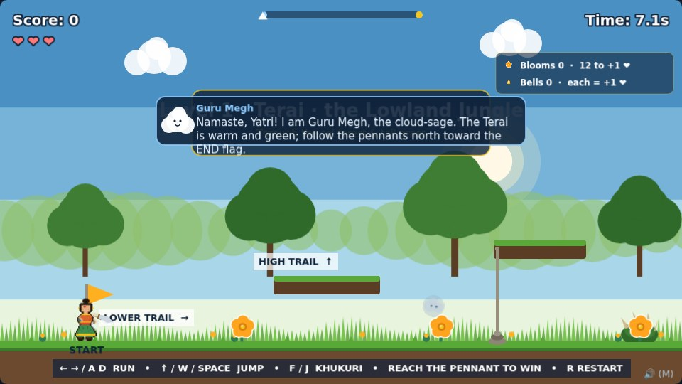
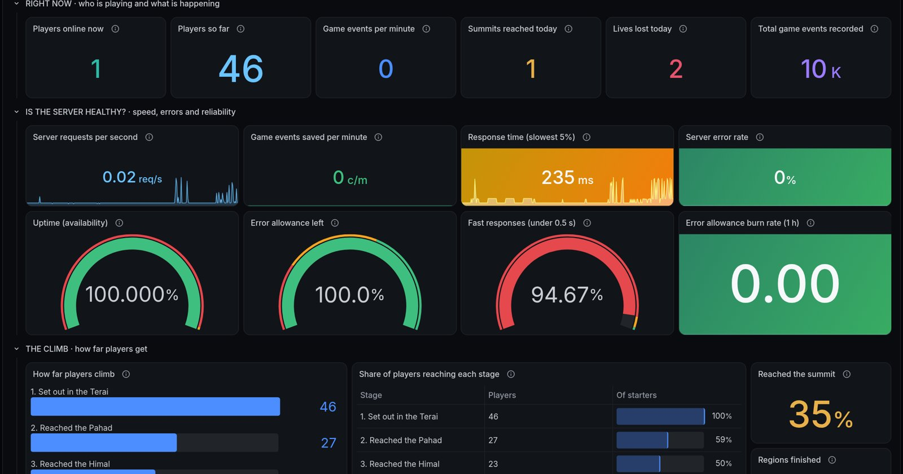

# Cloud Yatra

A 2D browser platformer that doubles as a live, full-stack observability demo.

You play Yatri, a Nepali traveller who climbs from the Terai lowland jungle through the Pahad
(middle hills) to the Himalayan summit. Every jump, fall and summit produces real telemetry. It
flows through a Cloudflare Worker into Grafana Cloud, and a dashboard under the game updates as
you play.

**Play it:** [cloud-yatra.pages.dev](https://cloud-yatra.pages.dev). It works with a keyboard on
desktop and with on-screen controls on phones and tablets (use landscape).

**Live dashboard:** [public Grafana dashboard](https://curioushalibut2108.grafana.net/public-dashboards/0bb04daf3f764307b6d0cea76a3de49e),
also embedded below the game.

All art and audio are original and generated in code. There are no asset files.





## Contents

- [Gameplay](#gameplay)
- [Controls](#controls)
- [Architecture](#architecture)
- [Observability](#observability)
- [Project layout](#project-layout)
- [Running locally](#running-locally)
- [Configuration](#configuration)
- [Deployment](#deployment)
- [Testing](#testing)
- [Cultural respect](#cultural-respect)

## Gameplay

- Run, jump (double-jump in the air) and swing a *khukuri* to cut through thorns, bamboo, nettle,
  tall grass and creeper vines.
- Collect the flowers of each region: Terai marigold, hill rhododendron (*lali gurans*) and the
  Himal blue poppy. Every 12 blooms make a garland. Two garlands earn an extra life.
- Prayer bells are rare. Each one scores points and restores a life when you are running low.
- Walking into an uncut obstacle is a warning the first time. Doing it repeatedly costs a life.
- Plant the pennant at a checkpoint to set your respawn point and bank your score.
- Watch for drifting mist, swooping eagles, falling rocks and a jungle monkey. Difficulty rises
  region by region.
- Guru Megh, a cloud-sage guide, gives short hints at key moments. His lines are written into the
  game and need no network.

## Controls

| Action | Desktop | Touch |
| --- | --- | --- |
| Move | Arrow keys or `A` / `D` | On-screen D-pad |
| Jump / double-jump | `↑`, `W` or `Space` (press again in the air) | Jump button (tap again in the air) |
| Khukuri | `F` or `J` | Khukuri button |
| Restart after a fall | `R` | Tap the card |
| Mute | `M` | |

Touch controls appear automatically on touch devices. In portrait the game asks you to rotate
to landscape.

## Architecture

Three independent parts: a static game, an optional backend, and Grafana Cloud. The game runs on
its own. The backend adds the shared leaderboard and the live dashboard.

```
Browser: Phaser game on Cloudflare Pages
   │  Faro Web SDK: web vitals, JS errors, sessions, gameplay events
   │  gameplay events and scores, sent in batches
   ▼
Cloudflare Worker (cloud-yatra-api) ─────────► Cloudflare D1 (SQLite)
   │  /faro        first-party passthrough ──► Grafana Faro
   │  every request: structured JSON log ─────► Loki
   │                 OTLP trace span ─────────► Tempo
   │  /metrics     scraped every minute by Grafana Cloud (Prometheus)
   │  /stats /leaderboard /recent /pulse       read by the Infinity data source
   │  /public-dashboards …  reverse proxy so the dashboard can be embedded
   ▼
Grafana Cloud: dashboards, SLOs, alert rules
```

| Part | Technology |
| --- | --- |
| Game | Phaser 3, TypeScript, Vite |
| Hosting | Cloudflare Pages |
| Backend | Cloudflare Worker, D1 |
| Observability | Grafana Cloud: Prometheus, Loki, Tempo, Faro, Infinity |

## Observability

| Signal | Source | How |
| --- | --- | --- |
| Metrics | Worker `/metrics` | Prometheus counters and a request-duration histogram (rate, errors, duration; p50/p90/p99) |
| Logs | Worker to Loki | One structured JSON log per request, each with a `correlationId` |
| Traces | Worker to Tempo | One OTLP span per request. Latency buckets carry trace exemplars |
| Real user monitoring | Browser to Faro | Web vitals, JS errors, sessions, gameplay events, sampled FPS |
| Analytics | D1 to Infinity | Leaderboard, recent runs, progression funnel, deaths by cause, country map |
| Reliability | Prometheus rules | Availability and latency SLOs, error-budget burn, alert rules |

Metric labels are kept low-cardinality (`route`, `status_class`, `type`, `cause`, region). There is
no personal data. Sessions are anonymous, the session ID appears only in logs and traces, never as
a metric label, and only a coarse country from Cloudflare is stored.

### Dashboards

`observability/dashboards/` holds one dashboard in two forms. Both are produced by
`node observability/build-dashboard.mjs`, which lays out the source and derives the public copy
from it, so the two never drift.

- `cloud-yatra-observatory.json` is the full dashboard (52 data panels, last 6 hours, refresh
  10 s). Import it into Grafana and map its data sources (Prometheus, Loki for backend logs, Loki
  for Faro, Tempo, Infinity). It adds the game embed, a per-session "Your run" row and the Tempo
  trace panels.
- `cloud-yatra-observatory-public.json` is the externally shared version embedded below the game
  (44 data panels, last 24 hours, refresh 30 s). Shared dashboards do not expand template
  variables, so the build writes the Worker URL, Faro app id and data source UIDs into every
  query, and uses fixed windows in place of `$__range` and `$__interval`.

The sections read top to bottom:

| Section | Source | What it shows |
| --- | --- | --- |
| Right now | D1 | Players online, players so far, events per minute, summits and lives lost today |
| Is the server healthy? | Prometheus | Requests, response time, error rate, uptime, error budget and burn rate |
| The climb | D1 | How far players get, share reaching each stage, summit rate |
| What players do | D1 | Activity per region, actions, causes of falls, flowers and bells |
| How the game feels | Faro | Web vitals, FPS over time and spread, browser errors |
| Server activity | Prometheus | Requests by route, p50/p90/p99 latency, status classes, rejected events |
| Server logs and traces | Loki, Tempo | Live request log, log levels, warnings and errors, traces (full dashboard) |
| Leaderboard | D1 | Rank, best score, run time, furthest region, country, last played |
| Around the world | D1 | Player map and top countries |
| Chaos Mode | D1, Prometheus | Storm status and strength, requests hit, past storms |
| How it's built | | The stack, from the browser to Grafana Cloud |

Every panel title is plain language and has a hover description. Single numbers sit in small
tiles beside the charts they summarise, and quiet panels show 0 or a short message instead of
"No data". A "Chaos storms" annotation draws a red band on every time series while a storm runs.
On a public share, turn on **Display annotations** in the sharing settings to show it.

Grafana Cloud blocks framing from other sites, so the Worker reverse-proxies the public dashboard
from its own address and removes the blocking headers.

Metrics reach Grafana through the **Metrics Endpoint** integration: add a scrape job for
`https://<worker>/metrics` with Bearer authentication using `METRICS_TOKEN`.

### Alert rules

- `prometheus-alert-rules.yaml`: standard Prometheus format. Import it under Alerting, Alert rules,
  Import to Grafana-managed rules.
- `grafana-alerts.yaml`: the same rules in Grafana provisioning format. Set the data source UID first.

### Chaos Mode

Chaos Mode is an admin-only fault injector inside the Worker. It lets the dashboard show a real
incident and its recovery, not only calm traffic.

1. Set the `CHAOS_ADMIN_TOKEN` secret on the Worker. Without it, Chaos Mode is disabled.
2. In the running game press `Shift+C`, enter the token and start a window of about 60 seconds.
3. During the window the Worker adds 600 ms of latency and about 25% synthetic `503` responses to
   the gameplay routes only. Health, metrics, control routes and external services are never
   affected, and the game keeps working.

The panel shows `ACTIVE` with the time left, and a red "Cloud storm" banner appears in the game.
Within one or two scrape intervals the error-rate and latency panels rise and the Chaos Mode alert
fires. When the window ends, or you press Stop, everything recovers. The window is stored in D1, so
every Worker instance sees the same state. Starting again extends the window.

## Project layout

```
cloud-yatra/
├── game/                Frontend: Phaser 3 + TypeScript + Vite
│   ├── index.html       Page shell: header, game, embedded dashboard
│   └── src/
│       ├── main.ts      Phaser setup, Faro, Chaos Mode panel
│       ├── config/      Constants, level data, player tuning, scoring
│       ├── scenes/      Boot, Menu, gameplay, Leaderboard
│       ├── entities/    Player, hazards, collectibles, checkpoints
│       ├── ui/          HUD, Guru Megh dialogue, touch controls
│       ├── audio/       Procedural music and sound effects
│       └── telemetry/   Event schema, sinks (console, Faro, HTTP), API and Chaos clients
├── backend/             Cloudflare Worker + D1
│   ├── migrations/      D1 schema
│   ├── src/             Router, database, validation, metrics, logger, CORS, chaos, proxies
│   └── test/            Worker tests
├── observability/       Grafana assets
│   ├── dashboards/      Source and public dashboard JSON
│   ├── build-dashboard.mjs
│   ├── prometheus-alert-rules.yaml
│   └── grafana-alerts.yaml
└── .github/workflows/   CI, deploy Pages, deploy Worker, reset leaderboard
```

## Running locally

Requires Node.js 20 or newer.

### Game

```bash
cd game
npm install
npm run dev          # http://localhost:5173
```

Other scripts in `game/`: `npm run build`, `npm run typecheck`, `npm run lint`, `npm test`.

### Backend (optional)

The game is fully playable without it.

```bash
cd backend
npm install
npm run lint
npm test                    # runs in the workerd runtime with an in-memory D1
npx wrangler dev --local    # local Worker with local SQLite
```

Routes:

- `GET`: `/healthz`, `/metrics`, `/stats`, `/leaderboard`, `/recent`, `/session`, `/pulse`,
  `/chaos/status`, `/chaos/events`
- `POST`: `/event`, `/events`, `/score`, `/chaos/start`, `/chaos/stop`

Public settings and the D1 binding are in `backend/wrangler.toml`.

## Configuration

### Game (public build-time variables)

Copy `game/.env.example` to `game/.env`. These values are public. Never put secrets in the client.

| Variable | Purpose |
| --- | --- |
| `VITE_API_BASE_URL` | Deployed Worker URL: telemetry, shared leaderboard and dashboard proxy. Leave empty to run offline with a local leaderboard. |
| `VITE_FARO_URL` | Grafana Faro collector. Use the Worker's `/faro` path so ad blockers do not drop it. Optional. |
| `VITE_FARO_APP_KEY` | Faro app key, only if your receiver needs one. Optional. |
| `VITE_GRAFANA_DASHBOARD_URL` | Grafana public dashboard URL (`/public-dashboards/<token>`), embedded below the game. |
| `VITE_GRAFANA_GRAND_URL` | Optional public link to the full dashboard, used as a fallback if the embed cannot load. |

With none of these set, the game still works: telemetry logs to the console in development, the
leaderboard uses local browser storage, and Guru Megh uses his built-in lines.

### Worker secrets

Secrets are never committed. They live in GitHub Actions secrets and the **Deploy backend Worker**
workflow pushes them to the Worker.

| Secret | Purpose |
| --- | --- |
| `METRICS_TOKEN` | Bearer token required by `/metrics`. |
| `CHAOS_ADMIN_TOKEN` | Enables the Chaos Mode control plane. |
| `GRAFANA_LOKI_URL`, `GRAFANA_LOKI_USER`, `GRAFANA_LOKI_TOKEN` | Push backend logs to Loki. |
| `GRAFANA_OTLP_URL`, `GRAFANA_OTLP_USER`, `GRAFANA_OTLP_TOKEN` | Push backend traces to Tempo. |

After changing a secret in GitHub, re-run the workflow. Values edited directly in Cloudflare are
overwritten on the next deploy.

## Deployment

GitHub Actions handles everything. It also needs the `CLOUDFLARE_API_TOKEN` and
`CLOUDFLARE_ACCOUNT_ID` secrets.

| Workflow | What it does |
| --- | --- |
| CI | Lint, type-check, test and build the game and the Worker on every push and pull request. |
| Deploy to Cloudflare Pages | Builds and publishes the game. Public settings come from repository variables. |
| Deploy backend Worker | Tests, applies D1 migrations, deploys the Worker and pushes its secrets. |
| Reset leaderboard | Manual only. Clears the shared leaderboard after you type a confirmation word. |

## Testing

| Part | Command | Tests |
| --- | --- | --- |
| Game | `cd game && npm test` | 84 unit tests (Vitest): levels, scoring, jump logic, camera, telemetry, Guru Megh lines |
| Worker | `cd backend && npm test` | 62 tests in the real `workerd` runtime with an in-memory D1 |

CI runs both suites, plus lint, type-check and both builds, on every push and pull request.

## Cultural respect

Cultural and national symbols (the *gunyu-cholo*, *dhaka topi*, *khukuri*, prayer flags, the Nepal
flag and *mani* stones) are used with respect and are never hazards. The background music is an
original composition. It is not Nepal's national anthem.
